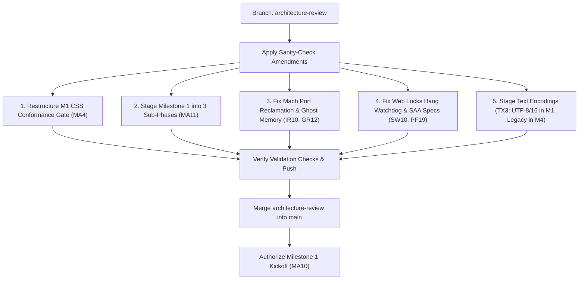

# Independent Architecture & Security Audit Report: Axiom (Branch `architecture-review`)

**Auditor:** Principal Browser Architect & Independent Security Auditor
**Date:** 2026-10-21
**Scope:** Architecture baseline on branch `architecture-review` at Phase Zero completion, incorporating Round 1 and Round 2 review amendments, spikes [S10](file:///Users/tawhid/Documents/Axiom/docs/research/s10-results.md), [S12](file:///Users/tawhid/Documents/Axiom/docs/research/s12-results.md), and [S15](file:///Users/tawhid/Documents/Axiom/docs/research/s15-results.md), and the [Milestone 1 Implementation Plan](file:///Users/tawhid/Documents/Axiom/docs/milestone-1.md).

---

## Executive Verdict

### **Verdict: Blocked by Findings**

The Phase Zero architectural baseline and the two preceding internal review rounds represent an exceptionally thorough foundation. The core invariants—deny-by-default Seatbelt sandboxing, memory-safe typed arenas, strict capability-based Mach IPC, and explicit budget discipline on 8 GB Apple Silicon—are sound in principle.

However, an adversarial audit from outside the Claude model family reveals **three critical architectural traps, two security blind spots, and a severe scheduling/burnout hazard** that must be refined before merging `architecture-review` into `main` and kicking off production code in Milestone 1:

1. **The M1 Conformance Gate Trap:** Requiring a $\ge 97.0\%$ pass rate over 5,652 CSS 2.1 reference tests in Milestone 1 requires a brand-new engine to outperform Safari (96.4%), Servo (93.7% after 14 years), and Ladybird (91.4% after 6 years). Combined with subtle platform traps in script-free test runners, this creates an unviable gate that will stall Milestone 1 indefinitely.
2. **Attack Surface Shift in the 3-Process Loop:** Direct ingestion of raw `IOSurface` Mach ports by the unsandboxed browser process shifts the kernel driver attack surface (`IOSurfaceRootUserClient`) into the highest-privilege domain (Z1), while dropped/unvalidated commits risk Mach port table exhaustion (`KERN_RESOURCE_SHORTAGE`).
3. **Ghost Memory Spiking on Renderer Termination:** Zero-copy Mach memory mapping in the GPU process causes orphaned memory entries to transfer their resident physical footprint entirely to the GPU process upon renderer crash or kill, triggering immediate cascading OOM crashes under budget [B1b](file:///Users/tawhid/Documents/Axiom/docs/security/process-model.md#7-memory-budgets-and-process-limits).
4. **The Multi-Process Concurrency Testing Vacuum:** Conformance testing runs only static pages, while scheduler and timer testing runs only in single-process mode under a deterministic virtual clock on in-memory queues. No test configuration validates concurrent event loops interacting asynchronously over Mach IPC under host preemptive scheduling.
5. **Orphaned Lock Deadlock via Hung Event Loops:** The browser-side `LockManager` only evicts locks on renderer *death*, while the [PF19](file:///Users/tawhid/Documents/Axiom/docs/performance.md) watchdog only monitors the *control thread*. An event loop hung in an infinite loop or stalled synchronous call will retain Web Locks indefinitely, permanently deadlocking all other tabs under that storage key.
6. **The Solo-Developer Scope Wall:** Implementing multi-process Mach IPC, Seatbelt sandboxing, CSS 2.1 layout with tables, text shaping, 4 image decoders, a TLS/HTTP2 network stack, an AppKit shell, and custom WHATWG encodings from scratch in safe Rust simultaneously before passing a single test is an insurmountable scope wall for a solo engineer.

---

## Detailed Evaluation of Audit Objectives

### 1. Multi-Process & Sandboxing Topology (The GPU/Compositor Process)

#### A. Attack Surface Shift: Ingesting Raw `IOSurface` Mach Ports in the Unsandboxed Browser

In [RV1-09](file:///Users/tawhid/Documents/Axiom/docs/review/round-1/02-findings.md#rv1-09-iosurfaces-in-renderers), Axiom properly recognized that opening `IOSurfaceRootUserClient` inside the renderer exposes the browser to kernel IOKit vulnerabilities, explicitly denying `iokit-open` in renderer Seatbelt profiles. In [RV1-02](file:///Users/tawhid/Documents/Axiom/docs/review/round-1/02-findings.md#rv1-02-compositing-stays-in-the-unsandboxed-browser-through-l3) and [S10](file:///Users/tawhid/Documents/Axiom/docs/research/s10-results.md), tile rasterization was moved to the GPU process, which sends `IOSurface` Mach port send rights to the browser process via `IOSurfaceCreateMachPort`.

The unsandboxed browser process receives these Mach ports and invokes `IOSurfaceLookupFromMachPort(port)` to bind the surface to `CALayer.contents`.

* **The Failure Mode:** `IOSurfaceLookupFromMachPort` creates an active client connection to `IOSurfaceRootUserClient` directly inside the **unsandboxed browser process (Z1)**. If an attacker exploits a memory corruption bug in the GPU process (e.g., via the Metal shader compiler service `com.apple.MTLCompilerService` or the `AGXDeviceUserClient` driver), the compromised GPU process can synthesize malformed `IOSurface` Mach ports or corrupted IOSurface memory metadata. When the privileged browser process inspects and maps these ports, any vulnerability in `IOSurfaceRootUserClient` or `libIOSurface` executes with the user's full, unsandboxed authority.
* **Precedent Comparison:** Neither WebKit nor Chromium directly exchanges raw per-tile `IOSurface` Mach ports with the UI process on every frame. WebKit uses `CAContext` remote layer hosting (`[CALayer contextId]`, `CALayerHost`), where the GPU process owns the CoreAnimation context and passes an opaque 32-bit integer identifier (`contextId`) to the UI process. The UI process never directly maps or unpacks raw `IOSurface` handles for web content tiles.

#### B. Mach Port Table Exhaustion & Lifetime Leakage

In Darwin's Mach IPC architecture, transferring a Mach port right via a port descriptor (`MACH_MSG_PORT_DESCRIPTOR`) moves or copies the right into the receiver's task port table (`ipc_entry_t`).

* [RV2-05](file:///Users/tawhid/Documents/Axiom/docs/review/round-2/03-findings.md#rv2-05-two-protocols-the-gpu-process-needs-from-m2) noted that live port rights artificially elevate an `IOSurface`'s global use count and mandated that the browser delete each port right immediately after `IOSurfaceLookupFromMachPort`.
* **The Blind Spot:** What happens during **dropped frames, queue backpressure, or validation failure**? Under [PF21](file:///Users/tawhid/Documents/Axiom/docs/performance.md), receive ports have queue limits (up to 1,024). If the browser process drops an incoming layer commit due to backpressure, or if a commit fails validation under [IR1](file:///Users/tawhid/Documents/Axiom/docs/security/process-model.md#62-trust-rules) / [IP11](file:///Users/tawhid/Documents/Axiom/docs/architecture/ipc.md#44-trust-enforced-by-types), the message body is dropped. In Mach IPC, port rights contained in dropped or unreceived messages are **not** automatically reclaimed unless the receiver explicitly parses the `mach_msg_body_t` and calls `mach_port_deallocate`.
* At 60 Hz across multiple tiles, leaking port descriptors will rapidly exhaust the process Mach port limit (default 65,536 entries), resulting in `KERN_RESOURCE_SHORTAGE` or `MACH_SEND_NO_BUFFER` and terminating the browser process.

#### C. Ghost Memory Footprint Spiking on Renderer Termination

In [S10-Q2](file:///Users/tawhid/Documents/Axiom/docs/research/s10-results.md#4-s10-q2-zero-copy-resources), the GPU process maps renderer memory entries (`mach_vm_map`) without copying and exposes them as linear textures. S10 measured that macOS charges the physical pages to the allocating process (the renderer) and observed that the GPU process's footprint does not increase while the renderer lives.

* **The Fatal Trap:** When a renderer crashes, is killed by the [PF19](file:///Users/tawhid/Documents/Axiom/docs/performance.md) watchdog, or exits during cross-site navigation, XNU terminates the renderer's task. However, the underlying `vm_object` remains alive because the GPU process holds active `vm_map_entry` references.
* Because the original owning task has ceased to exist, **the kernel's Mach VM subsystem re-attributes the resident memory footprint of those orphaned pages entirely to the surviving mapping task (the GPU process)!**
* If a renderer held 50–70 MiB of decoded images, the GPU process's physical footprint (`ri_phys_footprint`) will instantly spike by 50–70 MiB. Under budget [B1b](file:///Users/tawhid/Documents/Axiom/docs/security/process-model.md#7-memory-budgets-and-process-limits) ($\le 15$ MB + tile budget), this immediate spike will cause the browser's watchdog or macOS memory pressure handler to kill the GPU process every time a tab crashes or navigates.

#### D. Race Conditions & Tearing with `IOSurfaceIsInUse`

[RV2-05](file:///Users/tawhid/Documents/Axiom/docs/review/round-2/03-findings.md#rv2-05-two-protocols-the-gpu-process-needs-from-m2) and [GR12](file:///Users/tawhid/Documents/Axiom/docs/architecture/graphics.md#56-threads-memory-tests-and-the-gpu-process) propose checking `IOSurfaceIsInUse` on the CPU before the GPU process draws into a spare tile.

* `IOSurfaceIsInUse` is an instantaneous CPU-side read of an internal kernel lock count (`IOSurfaceLock` / `IOSurfaceUnlock`).
* Metal rendering is asynchronous: commands encoded into `MTLCommandBuffer` execute on the GPU timeline hundreds of microseconds or milliseconds after CPU dispatch.
* Relying on CPU-side `IOSurfaceIsInUse` without cross-process GPU-timeline synchronization (e.g. `MTLSharedEvent` shared between the GPU process and the browser's CoreAnimation compositor, or waiting for `addCompletedHandler:`) introduces race conditions. If CoreAnimation or the WindowServer lags by even a fraction of a frame, `IOSurfaceIsInUse` can return `false` on the CPU while the display scan-out or compositor rasterizer is still reading the surface, causing visual tearing and buffer corruption.

---

### 2. Milestone 1 Conformance & Script-Free Scope

#### A. The Target Is a Mathematically and Practically Unviable Trap

Milestone 1 targets a $\ge 97.0\%$ pass rate over the **5,652 script-free reference tests** in WPT `css/CSS2` ([MA4](file:///Users/tawhid/Documents/Axiom/docs/milestone-1.md#4-acceptance-criteria)).

* Round 1 ([RV1-01](file:///Users/tawhid/Documents/Axiom/docs/review/round-1/02-findings.md#rv1-01-milestone-1-s-css-target-and-harness-need-script)) discovered that 196 tests contained script and lowered the denominator from 5,848 to 5,652. However, it retained the shipping browser median (97.8% rounded down to 97%).
* **Consider the reality of existing web engines on these exact 5,652 tests:**
  * Chrome Canary: 98.2%
  * Firefox: 97.8%
  * Safari: 96.4% (**Safari FAILS Axiom's Milestone 1 acceptance gate!**)
  * Servo (after 14 years of multi-engineer development): 93.7%
  * Ladybird (after 6 years of development): 91.4%
* Requiring a solo developer to implement a from-scratch CSS 2.1 engine that **beats Safari and surpasses Servo and Ladybird on Milestone 1** is an extreme standard. Passing 97.0% requires passing at least **5,483 tests**, allowing fewer than 169 failures across the entire breadth of CSS 2.1 (nested margin collapsing, complex bidi reordering, generated content counters, absolute positioning in scrolling containing blocks, and table layout). This gate cannot realistically be achieved without years of edge-case debugging.

#### B. Hidden Traps in "Script-Free" Reference Tests

1. **The Reference File Script Dependency Flaw in `tools/wpt-script-deps.py`:**
   Inspection of [tools/wpt-script-deps.py](file:///Users/tawhid/Documents/Axiom/tools/wpt-script-deps.py#L88-L110) reveals a blind spot: the script only inspects the *test file* for `<script>` and `reftest-wait`. It **never parses or inspects the `<link rel="match">` reference file**. In WPT, many reference files use inline scripts, canvas drawing, or dynamic DOM manipulation to construct the reference image. Any test whose reference file uses script was falsely classified as "script-free" and will fail in Axiom's script-free runner.
2. **The Asynchronous Font Readiness Barrier:**
   In WebDriver-driven WPT harnesses, the runner evaluates `document.fonts.ready` before capturing a screenshot. In a script-free harness (`axiom-headless URL output.png`), if a test references `@font-face` (such as `Ahem.ttf`), the headless browser must implement a native asynchronous font load barrier that delays the screenshot until all web fonts are rasterized into glyph atlases. If layout occurs before font loading completes, the screenshot captures fallback glyphs, causing immediate pixel mismatches.
3. **Subpixel Antialiasing Mismatches:**
   Older WPT `css/CSS2` tests do not include `<meta name="fuzzy">` tolerances; they rely on 100% binary pixel identity. Axiom uses CoreText for system fonts and `vello_cpu` / `skrifa` for web fonts ([TX12](file:///Users/tawhid/Documents/Axiom/docs/architecture/text-and-fonts.md), [TX21](file:///Users/tawhid/Documents/Axiom/docs/architecture/text-and-fonts.md)). Even fractional pixel hinting differences or subpixel anti-aliasing variations between rasterizers will cause tests to register false-negative failures.
4. **Interactive Pseudo-Classes:**
   `css/CSS2` contains tests for dynamic pseudo-classes (`:hover`, `:active`, `:focus`). A purely static screenshot runner cannot trigger these states without synthetic input events or WebDriver actions.

---

### 3. Hybrid Testing Configuration

#### A. The Multi-Process Concurrency Vacuum

In Round 2 ([RV2-03](file:///Users/tawhid/Documents/Axiom/docs/review/round-2/03-findings.md#rv2-03-which-process-configuration-runs-the-conformance-suites)), Axiom adopted a hybrid configuration: WPT conformance runs across real sandboxed OS processes on host time, while timer and scheduler tests run in single-process mode under a deterministic virtual clock ([EL24](file:///Users/tawhid/Documents/Axiom/docs/architecture/event-loop-and-threading.md#49-determinism-and-tests)).

* In Milestone 1, WPT runs **only script-free, static reference tests**. These tests load a static document once, render a frame, write a PNG, and terminate. They exercise no timers, no asynchronous message interleavings, and no preemption.
* Conversely, all tests that involve timers, animations, and task scheduling execute **on a single OS thread** in single-process mode under a cooperative virtual scheduler.
* **The Failure Mode:** **Zero test suites evaluate real-world multi-process concurrency!** The following race conditions are completely masked by the test harness:
  * Network chunk arrivals racing against HTML parser yields ([PF23](file:///Users/tawhid/Documents/Axiom/docs/performance.md) parser yield deadlines).
  * Vsync frame offers from the browser compositor racing against display-list updates from a preempted renderer.
  * IPC backpressure stalls and Mach `MACH_NOTIFY_SEND_POSSIBLE` wakeups across separate OS process queues under CPU contention.

#### B. In-Memory Queue vs. Mach Port Semantic Divergence

Rule [IP2](file:///Users/tawhid/Documents/Axiom/docs/architecture/ipc.md#41-transport) states that in single-process mode, channels are in-memory queues.

* In-memory queues do not simulate Mach queue limits (`MACH_PORT_QLIMIT_BASIC` = 5, `MACH_PORT_QLIMIT_LARGE` = 1,024), kernel message buffers, or Mach descriptor allocations.
* Testing schedulers and event loops exclusively on in-memory queues guarantees that Mach-specific message loss, send-possible notification races, and priority inversion bugs will escape detection until integration.

---

### 4. Storage Partitioning & Web Locks

#### A. Orphaned Lock Deadlock via Hung Event Loops

In [RV2-04](file:///Users/tawhid/Documents/Axiom/docs/review/round-2/03-findings.md#rv2-04-when-a-shared-helper-dies-or-hangs), Axiom moved Web Locks arbitration into the browser process (`LockManager`) to prevent helper process crashes from violating mutual exclusion. Rule [SW10](file:///Users/tawhid/Documents/Axiom/docs/architecture/storage-and-workers.md#53-workers) specifies: *"a renderer's death releases the locks its agents held."*

* **The Deadlock Scenario:** What happens when a renderer's event-loop thread hangs or enters an infinite loop while holding a lock?
  ```javascript
  navigator.locks.request('storage_sync', async (lock) => {
    while (true) {} // Infinite loop or blocked on hung sync IPC
  });
  ```
* The renderer process has not died (`EVFILT_PROC` does not fire).
* Does the [PF19](file:///Users/tawhid/Documents/Axiom/docs/performance.md) watchdog detect this? **No.** Under PF19: *"The browser pings each renderer's control thread once a second."* The control thread is idle in `kevent64` and responds to the ping. Unless the user actively clicks or types into that specific tab, the hang is never detected.
* Consequently, the lock remains registered as granted in the browser's `LockManager`. **Every other tab, window, or worker under that storage key that requests `'storage_sync'` will be permanently blocked**, deadlocking client-side databases across the entire browser session.
* **Remedy:** The browser's `LockManager` must implement per-request acquisition timeouts, client heartbeats tied directly to the requesting agent's event-loop thread, and the ability to forcibly break and revoke orphaned locks when an agent fails responsiveness checks.

#### B. Ancestor Chain Bit & Cross-Embedder Collusion

[RV2-10](file:///Users/tawhid/Documents/Axiom/docs/review/round-2/03-findings.md#rv2-10-the-storage-key-lacks-the-ancestor-chain-bit) correctly introduced an ancestor chain bit into `StorageKey` to partition `A → B → A` from `A`.

* In Privacy Sandbox standards, `StorageKey` is `(origin, top_level_site, has_cross_site_ancestor)`.
* **The Nuance:** If `has_cross_site_ancestor` is a single boolean flag, consider:
  * Frame 1: Top-level `https://a.com` embeds `https://b.com`, which embeds `https://a.com` $\rightarrow$ Storage Key: `(a.com, a.com, true)`.
  * Frame 2: Top-level `https://a.com` embeds `https://c.com`, which embeds `https://a.com` $\rightarrow$ Storage Key: `(a.com, a.com, true)`.
* Notice that `A` embedded in `B` and `A` embedded in `C` share the exact same storage key! This allows embedder `B` and embedder `C` to establish a cross-embedder communication side-channel through `A`'s shared third-party partition. Axiom should document whether this cross-embedder channel is accepted (matching Chromium's current behavior) or if further partitioning is required.

---

### 5. Feasibility for a Solo Developer

#### A. The Text Encodings Scope Trap

In [RV1-08](file:///Users/tawhid/Documents/Axiom/docs/review/round-1/02-findings.md#rv1-08-scope-against-one-developer), Claude audited `encoding_rs` 0.8.42 and graded it `ub-risk-3` because 121 of 143 unsafe blocks lacked safety comments, and it used an empty `asm!` optimization barrier ([audit](file:///Users/tawhid/Documents/Axiom/docs/research/encoding-rs-audit.md)). Because dependency policy [DP8](file:///Users/tawhid/Documents/Axiom/docs/technology/dependency-policy.md) requires `ub-risk-2`, Axiom decided to implement all WHATWG text encodings in safe Rust ([TX3](file:///Users/tawhid/Documents/Axiom/docs/architecture/text-and-fonts.md)).

* **The Reality Check:** Implementing WHATWG-compliant decoders for 30+ legacy character sets—especially complex East Asian multi-byte encodings like GB18030, Big5, Shift_JIS, and ISO-2022-JP—is an enormous engineering undertaking involving thousands of non-contiguous mapping tables and intricate error-replacement state machines.
* **Why this is unnecessary for Milestone 1:**
  * Wikipedia and MDN are 100% UTF-8.
  * WPT `css/CSS2` tests are UTF-8, US-ASCII, or UTF-16.
  * Requiring a solo developer to write legacy Asian encodings before Milestone 1 can render a static document is severe scope creep.
* **Remedy:** Milestone 1 should implement **only UTF-8 and UTF-16**. All legacy encodings must be staged to a later milestone (M4/M5). Alternatively, admit `encoding_rs` under [DP10](file:///Users/tawhid/Documents/Axiom/docs/technology/dependency-policy.md)'s exception: `encoding_rs` executes exclusively inside the sandboxed renderer (Z3), where the threat model already assumes renderer compromise ([AD2](file:///Users/tawhid/Documents/Axiom/docs/security/threat-model.md#4-adversaries)).

#### B. Staging Milestone 1 to Prevent Developer Burnout

Milestone 1 as currently defined ([MA1](file:///Users/tawhid/Documents/Axiom/docs/milestone-1.md#2-scope)) is monolithic:

```
M1 Scope = Mach IPC + Seatbelt Sandboxing (3 processes) + Full HTML5 Parser +
           CSS 2.1 Engine (including tables) + HarfRust/CoreText/ICU4X Text Shaping +
           4 Image Decoders (PNG, JPEG, GIF, WebP) + TLS/HTTP2 Network Stack +
           Native AppKit Shell + Headless Test Harness (6 text dumps) +
           ≥ 97% CSS 2.1 Conformance Gate
```

Attempting to implement all of these layers simultaneously before obtaining a working feedback loop creates a massive integration bottleneck.

---

## Additional Architectural & Security Blind Spots

### 1. Global Mach Bootstrap Rendezvous vs. Port Inheritance

In [IP4](file:///Users/tawhid/Documents/Axiom/docs/architecture/ipc.md#42-channels-and-endpoints) and [S4](file:///Users/tawhid/Documents/Axiom/docs/research/s4-results.md), spawned child processes locate the browser by calling `bootstrap_look_up("org.axiom.<id>")` in the system launchd namespace.

* **The Vulnerability:** `bootstrap_check_in` registers a service name in the per-user Mach bootstrap namespace. Any other application running under the user's account can discover and connect to this port.
* Furthermore, this requires granting `(allow mach-lookup (global-name "org.axiom.*"))` in every helper's Seatbelt profile and retaining access to `bootstrap_port`.
* **Standard Industry Practice:** Chromium and WebKit do not use global bootstrap names for helper IPC. They use **Mach port inheritance via `posix_spawnattr_setmacpolicyinfo_np` / `mach_ports_register`**, or pass an initial Mach port over the inherited socket/file descriptor that is already used to send the compiled sandbox profile. Axiom already inherits a socket for sandbox bytecode; registering in global launchd is an unnecessary attack surface.

### 2. Synchronous IPC Watchdog Disconnect in IP13

Rule [IP13](file:///Users/tawhid/Documents/Axiom/docs/architecture/ipc.md#45-synchronous-requests) states: *"Synchronous requests (cookies, storage, synchronous XHR) have no timeout of their own: their answer is bounded by PF19, since the caller's thread is the one being watched."*

* As noted in Finding 4A, **the thread making synchronous calls is the event-loop thread, while [PF19](file:///Users/tawhid/Documents/Axiom/docs/performance.md) pings the control thread.**
* If the network process stalls on a disk write or lock, the event-loop thread hangs indefinitely. The control thread remains responsive to browser pings. Unless input is sent to that specific tab, the browser never detects the hung synchronous call, resulting in an indefinite UI stall.

---

## Actionable Recommendations & Staging Plan

Before merging branch `architecture-review` into `main`, apply the following targeted amendments:



### Recommendation 1: Restructure the M1 Conformance Gate ([MA4](file:///Users/tawhid/Documents/Axiom/docs/milestone-1.md#4-acceptance-criteria))

* Replace the flat $\ge 97.0\%$ CSS 2.1 pass rate with a realistic, phased conformance gate:
  * **Milestone 1 Target:** $\ge 88.0\%$ pass rate over core static CSS 2.1 reference tests (`normal-flow`, `margin-padding-clear`, `positioning`, `borders`), consistent with early-stage engines (Ladybird 91.4%, Servo 93.7%).
  * Explicitly exclude tests requiring dynamic pseudo-classes (`:hover`, `:focus`) and `@font-face` network loads until the script/WebDriver harness arrives.
  * Retain the full $\ge 97.0\%$ target for **Milestone 3**, where WebDriver, the full JavaScript runtime, and dynamic test harnesses are active.

### Recommendation 2: Stage Milestone 1 Implementation ([MA11](file:///Users/tawhid/Documents/Axiom/docs/milestone-1.md#6-starting-it))

Split Milestone 1 into three sequential internal checkpoints:

* **M1-A (Core Layout & Static Renderer):** Single-process, headless embedder, local `file:` only. Implements HTML parsing, CSS 2.1 box formatting, HarfRust/CoreText text shaping, and PNG/JPEG decoding. Validates against WPT tree construction and static reference tests.
* **M1-B (Multi-Process & Sandboxing Topology):** Introduces real `axiom-renderer` and `axiom-network` processes over Mach IPC under Seatbelt profiles. Validates zero-copy memory entries, crash recovery, and port hygiene.
* **M1-C (Network Stack & AppKit Shell):** Integrates rustls, HTTP/1.1 & HTTP/2, DNS-SD, and the native AppKit window with CoreAnimation presentation.

### Recommendation 3: Reclaim Ghost Memory & Mach Port Descriptors ([GR12](file:///Users/tawhid/Documents/Axiom/docs/architecture/graphics.md), [IR10](file:///Users/tawhid/Documents/Axiom/docs/security/process-model.md))

* **Ghost Memory:** Add an explicit lifecycle rule to [GR13](file:///Users/tawhid/Documents/Axiom/docs/architecture/graphics.md) / [IR10](file:///Users/tawhid/Documents/Axiom/docs/security/process-model.md): when the browser notifies the GPU process of a renderer's termination, the GPU process must immediately unmap (`mach_vm_deallocate`) all memory entries registered by that renderer to prevent resident memory footprint attribution spikes.
* **Port Hygiene:** Update [IP5](file:///Users/tawhid/Documents/Axiom/docs/architecture/ipc.md) / [IP16](file:///Users/tawhid/Documents/Axiom/docs/architecture/ipc.md): the IPC message dispatch loop must guarantee that whenever a message containing Mach port descriptors is dropped (via queue overflow or validation error), the port rights are explicitly deallocated via `mach_port_deallocate`.
* **GPU Timeline Sync:** Amend [GR12](file:///Users/tawhid/Documents/Axiom/docs/architecture/graphics.md) to require `MTLSharedEvent` or command buffer completion callbacks (`addCompletedHandler:`) in addition to `IOSurfaceIsInUse` before tile surfaces are reused.

### Recommendation 4: Fix Web Locks Watchdog & Storage Access ([SW10](file:///Users/tawhid/Documents/Axiom/docs/architecture/storage-and-workers.md), [PF19](file:///Users/tawhid/Documents/Axiom/docs/performance.md))

* Amend [SW10](file:///Users/tawhid/Documents/Axiom/docs/architecture/storage-and-workers.md): `LockManager` must track the event-loop responsiveness of lock holders. If an agent holds a lock but fails an event-loop ping or exceeds a maximum execution duration, the browser must revoke the lock and terminate the agent to prevent session-wide deadlock.
* Amend [IP13](file:///Users/tawhid/Documents/Axiom/docs/architecture/ipc.md) / [PF19](file:///Users/tawhid/Documents/Axiom/docs/performance.md): the hang watchdog must monitor the **event-loop thread**, not merely the control thread, when synchronous IPC requests are outstanding.

### Recommendation 5: Stage Text Encodings ([TX3](file:///Users/tawhid/Documents/Axiom/docs/architecture/text-and-fonts.md))

* Amend [TX3](file:///Users/tawhid/Documents/Axiom/docs/architecture/text-and-fonts.md) and [MA1](file:///Users/tawhid/Documents/Axiom/docs/milestone-1.md): Milestone 1 requires **only UTF-8 and UTF-16** decoders in safe Rust.
* Stage all legacy multi-byte and single-byte encodings (GB18030, Big5, Shift_JIS, windows-1252) to Milestone 4, or admit `encoding_rs` inside the sandboxed renderer process under [DP10](file:///Users/tawhid/Documents/Axiom/docs/technology/dependency-policy.md).

---

## Final Go/No-Go Recommendation

### **Recommendation: CONDITIONAL GO (Hold Merge Until Amendments Applied)**

1. **DO NOT** merge `architecture-review` into `main` immediately.
2. Apply the five focused refinements above to `docs/milestone-1.md`, `docs/adr/0021-milestone-1.md`, `docs/architecture/graphics.md`, `docs/architecture/ipc.md`, and `docs/architecture/storage-and-workers.md`.
3. Once these adjustments are committed and verified with the repository's five validation checks (`cargo test`, `check-unsafe-policy.sh`, `check-doc-links.py`), **merge `architecture-review` into `main`** and authorize the Milestone 1 implementation kickoff.
